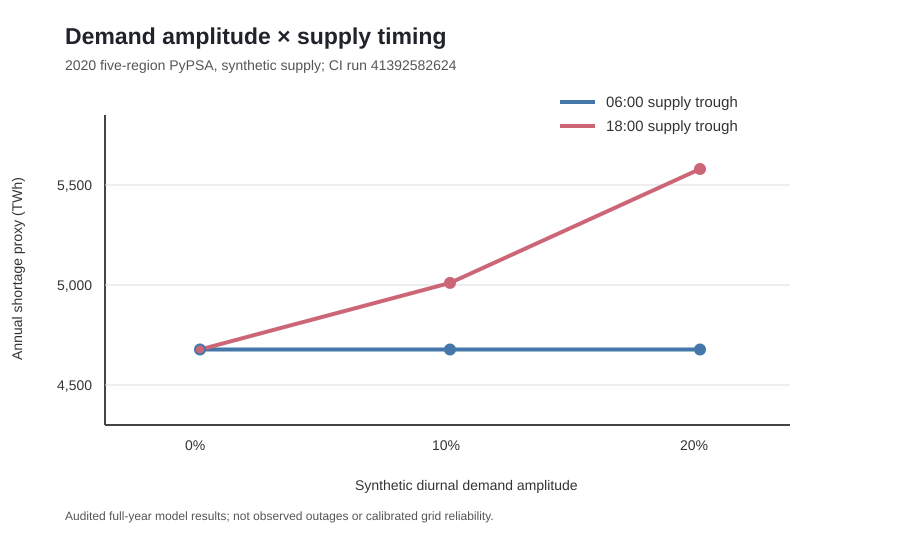
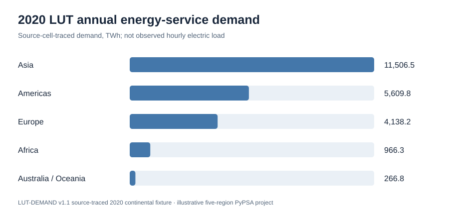
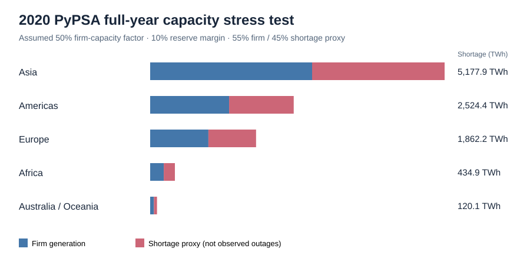
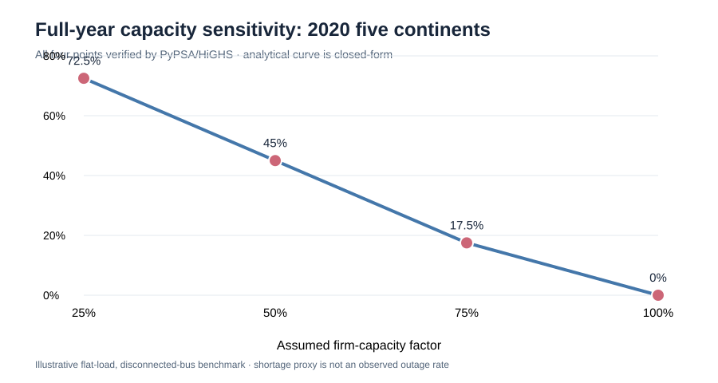

# LUT-to-PyPSA: Energy Demand Scenario Integration and Validation

[](https://github.com/ys30/lut-to-pypsa/actions/workflows/tests.yml)

A small, reproducible **electricity-only** portfolio project demonstrating how to validate tabular energy-system data, harmonize units, construct a PyPSA network, and distinguish input checks from optimization results.

> **Data provenance and limitations:** The repository includes both **synthetic demonstration inputs** and a small, **source-cell-traced authentic LUT-DEMAND v1.1 annual electricity energy-service-demand fixture** (2020, five continents; `data/derived/lut_continents_2020_verified.csv`). The original workbook is not bundled. Hourly shapes, firm generation and shortage generators are illustrative assumptions, not observed data. This project does **not** establish LUT-ESTM/PyPSA output equivalence or calibration.

**Verification and scientific scope:** [Read the project audit and limitations](docs/VERIFICATION_AND_LIMITATIONS.md), including verified CI, controlled sensitivity results, known confounding, and the boundary between a portfolio demonstration and calibrated empirical research.

## What it does

- Validates required columns, nulls, unique region/generator IDs, valid region references, nonnegative capacities/costs/demand, timestamps, unique region–snapshot pairs, and complete region coverage.
- Converts demand expressed as **GWh per one-hour interval** to PyPSA load `p_set` in **MW** (`GWh × 1000 / 1 hour`). The one-hour assumption is explicit and must be revised for other time resolutions.
- The original small demonstration creates three independent regional buses, six generators and 24 hourly snapshots; the separate **five-continent acceptance pipeline** instead runs 8,784 hourly snapshots for 2020 with five regional buses and illustrative firm/shortage generators. **Neither setup includes transmission links, storage, capacity-expansion decisions, or multi-sector coupling.**
- Optionally solves dispatch with HiGHS and exports a PyPSA NetCDF network.
- Includes unit tests, a PyPSA integration test, notebooks, and GitHub Actions.

## Verified five-continent illustrative dispatch sensitivities (November 2026)

**Key controlled finding:** With the same installed firm capacity and the same source-traced annual energy demand, a synthetic 20% evening demand peak aligned with a synthetic 40% firm-availability dip increases the annual shortage **proxy** from **4,677.433 TWh** (06:00 availability trough) to **5,579.834 TWh** (18:00 trough), a difference of **902.402 TWh**. This is a **conditional model sensitivity**, not a prediction of real electricity shortages.

**Reproducibility:** [View the passing four-workflow verification at commit d21b7ec](https://github.com/ys30/lut-to-pypsa/actions/runs/41398930061), inspect the [six-scenario audit](https://github.com/ys30/lut-to-pypsa/actions/runs/41392582624), or use the versioned figure and the downloadable CSV/PNG artifact below.


**CI verified:** [five-region acceptance run #41363699243](https://github.com/ys30/lut-to-pypsa/actions/runs/41363699243) completed successfully, including the full-year (8,784-hour) synthetic diurnal-load PyPSA solve, energy-balance audit, and comparison with the flat-load 50%-firm-capacity stress case. The existing four full-year capacity scenarios and visualization checks also passed.

This is a **methodological sensitivity test**, not a measured electricity load curve: `hourly_diurnal` uses a daily cosine pattern with default amplitude 0.20 and an illustrative 18:00 peak, preserving each continent's original annual LUT demand. No observed hourly regional demand, generation mix, interconnection, or storage is inferred.

**Verified numerical comparison (run #41385598796):** flat-load shortage proxy **10,119.445 TWh**; synthetic-diurnal shortage proxy **7,645.803 TWh**; difference **−2,473.642 TWh** (−24.44% relative to the flat case). These are actual solved annual totals under the stated assumptions, not measured power-system shortages. **Important confounding caveat:** this initial comparison also changed installed firm capacity because each scenario resized the assumed generator to its own hourly peak; the −24.44% change is **not** a load-shape-only effect. The subsequent fixed-capacity control recovered the same 10,119.445 TWh shortage proxy for flat and diurnal demand (difference below numerical tolerance). Only the later fixed-capacity time-varying-availability experiments isolate a conditional timing effect.

### Audited demand-amplitude × supply-phase figure



The versioned SVG above visualizes the **CI-verified** six-scenario results (run [#41392582624](https://github.com/ys30/lut-to-pypsa/actions/runs/41392582624)). The SVG uses the verified rounded totals, while the pipeline-generated PNG and CSV preserve the full-precision solver outputs. **CI now verifies the SVG's machine-readable six-scenario values against the newly solved CSV**, failing if any value drifts beyond 0.0005 TWh ([verified run #41401392555](https://github.com/ys30/lut-to-pypsa/actions/runs/41401392555)).


The CI figure generator renders `outputs/figures/five_region_amplitude_phase_sensitivity.png` from the six verified solver scenarios in `outputs/five_region/amplitude_phase_sensitivity.csv`. It validates that all six amplitude/phase combinations are present before plotting. [Download the verified figure and CSV results from run #41396036448](https://github.com/ys30/lut-to-pypsa/actions/runs/41396036448/artifacts) (artifact: `five-region-illustrative-results`). A versioned SVG is embedded above for immediate viewing; the CI artifact contains the generated full-precision PNG and CSV for independent verification. The figure explicitly identifies the data as illustrative full-year PyPSA solves rather than measured outages.

### Demand-amplitude × supply-phase interaction (CI verified)

[Full-year five-region acceptance run #41392582624](https://github.com/ys30/lut-to-pypsa/actions/runs/41392582624) verified six 8,784-hour PyPSA solves at fixed installed capacity (assumed firm-capacity factor 0.90), synthetic supply-availability dip amplitude 0.40, and the same source-traced 2020 annual demand. The demand diurnal amplitude varies while the synthetic supply trough occurs at either 06:00 or 18:00.

| Synthetic demand amplitude | 06:00 supply trough (TWh) | 18:00 supply trough (TWh) | Aligned-minus-opposite (TWh) |
| --- | ---: | ---: | ---: |
| 0% | 4,677.433 | 4,677.433 | 0 |
| 10% | 4,677.433 | 5,010.324 | +332.891 |
| 20% | 4,677.433 | 5,579.834 | +902.402 |

At zero demand amplitude, changing the availability trough hour has no effect, as expected. With stronger synthetic evening demand peaks, aligning the imposed supply trough at 18:00 increases the shortage proxy, whereas the opposite-phase scenarios remain unchanged in this particular capacity regime. The relationship is **conditional on the model's binding capacity constraints** and is not an empirical forecast or a universal monotonicity claim.

CI checks equal annual demand and installed capacity across all six scenarios, optimal solver termination, and hourly power balance. The audited table is exported as `outputs/five_region/amplitude_phase_sensitivity.csv`.

### Four-phase availability sensitivity (CI verified)

The [five-region acceptance run #41391314480](https://github.com/ys30/lut-to-pypsa/actions/runs/41391314480) solved four 8,784-hour cases with the **same** 2020 source-traced annual demand, synthetic demand peak at 18:00, firm-capacity factor 0.90, fixed installed capacity, and a 40% synthetic availability dip. Only the availability trough hour changes.

| Availability trough hour | Annual shortage proxy (TWh) | Change relative to 18:00 (TWh) |
| --- | ---: | ---: |
| 00:00 | 4,932.813 | −647.022 |
| 06:00 | 4,677.433 | −902.402 |
| 12:00 | 4,932.813 | −647.022 |
| 18:00 | 5,579.834 | 0 |

The imposed 18:00 demand peak and 18:00 supply trough produce the largest shortage proxy. Moving the supply trough 12 hours earlier gives the smallest. The symmetric 00:00/12:00 values are consistent with the symmetric synthetic daily profiles. The audited CSV `outputs/five_region/availability_four_phase_sensitivity.csv` is included in the CI artifacts and job summary.

**Interpretation:** This is a controlled sensitivity experiment on synthetic time profiles. It is not an estimate of real-world outages, and these four illustrative phases alone do not establish empirical robustness.

### Supply-demand phase alignment (verified)

[Five-region acceptance run #41389704952](https://github.com/ys30/lut-to-pypsa/actions/runs/41389704952) verified a controlled 8,784-hour phase-shift experiment at assumed firm-capacity factor 0.90, synthetic 20% diurnal demand amplitude, and synthetic 40% supply-availability dip. Both scenarios retain the same annual demand, installed capacities, hourly demand series, and daily availability distribution; only the hour of the synthetic supply trough changes.

| Synthetic supply trough | Demand peak | Shortage proxy (TWh) |
| --- | --- | ---: |
| 18:00 (aligned) | 18:00 | 5,579.834 |
| 06:00 (opposite phase) | 18:00 | 4,677.433 |

Moving the assumed supply trough to 06:00 reduces the shortage proxy by **902.402 TWh (16.17% relative to the aligned case)**. This is a sensitivity of the illustrative dispatch model to imposed daily phase alignment, **not** a measured grid reliability benefit or an estimate of real-world outages. The workflow exports `outputs/five_region/availability_phase_shift_control.csv` with per-region deltas and checks identical annual demand and installed capacity.

Reproduce the opposite-phase case:

```bash
python -m lut_to_pypsa.five_region_pipeline --annual data/derived/lut_continents_2020_verified.csv --year 2020 --load-profile diurnal --diurnal-amplitude 0.20 --firm-capacity-factor 0.9 --capacity-reference flat_reference --firm-availability-amplitude 0.4 --availability-trough-hour 6 --output outputs/five_region_availability40_factor90_trough06
```

### Time-varying supply and load-timing sensitivity (verified)

[Full-year five-region acceptance run #41388435458](https://github.com/ys30/lut-to-pypsa/actions/runs/41388435458) solved two additional fixed-nameplate scenarios with an illustrative 18:00 firm-availability dip (amplitude 0.4; minimum availability 60%). Both use the same source-traced 2020 LUT annual demand, 8,784 hours, identical installed firm capacities, and identical hour-by-hour availability constraints.

| Assumed firm-capacity factor | Flat demand shortage proxy (TWh) | Synthetic diurnal demand shortage proxy (TWh) | Shape-only change (TWh) |
| --- | ---: | ---: | ---: |
| 0.50 | 12,593.088 | 12,593.088 | ≈0 |
| 0.90 | 4,677.433 | 5,579.834 | **+902.402** |

At 90% capacity, the synthetic 18:00 demand peak coincides with the imposed 18:00 supply-availability trough, increasing the modeled shortage proxy by **19.29%** relative to the flat-load case. At 50% capacity, the assumed system is shortage-constrained essentially throughout the day, and reshaping annual-conserving load leaves total shortage unchanged. These outcomes are **conditional on invented hourly patterns and capacity assumptions**, not calibrated reliability estimates.

Reproduce the 90% experiment:

```bash
python -m lut_to_pypsa.five_region_pipeline --firm-capacity-factor 0.9 --capacity-reference flat_reference --firm-availability-amplitude 0.4 --load-profile flat --output outputs/availability40_flat90
python -m lut_to_pypsa.five_region_pipeline --firm-capacity-factor 0.9 --capacity-reference flat_reference --firm-availability-amplitude 0.4 --load-profile diurnal --diurnal-amplitude 0.2 --output outputs/availability40_diurnal90
```

CI exports `outputs/five_region/availability40_factor90_shape_control.csv` with region-level comparisons. The model still has no empirical hourly demand, observed generation, interregional lines, or storage.

### Fixed-capacity control: validated causal decomposition of model assumptions

[Successful full-year PyPSA acceptance run #41386235585](https://github.com/ys30/lut-to-pypsa/actions/runs/41386235585) held the illustrative firm generator capacity constant while changing the hourly demand shape. All three scenarios retain identical LUT annual demand, 50% assumed firm-capacity factor, 10% reserve margin, and 8,784 hourly snapshots.

| Full-year illustrative scenario | Shortage-proxy generation (TWh) |
| --- | ---: |
| A. Flat load, capacity based on flat peak | 10,119.445 |
| B. Synthetic diurnal load, **same firm capacity as A** | 10,119.445 |
| C. Synthetic diurnal load, capacity resized to diurnal peak | 7,645.803 |

**A → B (load shape only):** effectively **0.000 TWh** (numerical residual less than 10⁻⁹ TWh). **B → C (capacity resizing):** **−2,473.642 TWh**, explaining the entire apparent −24.44% shortage-proxy change in the earlier non-controlled comparison. The result is specific to this unconstrained dispatchable-firm, high-cost-shortage, flat-vs-cosine model: it is not evidence that hourly load shape never matters in realistic systems.

Reproduce the fixed-capacity control:

```bash
python -m lut_to_pypsa.five_region_pipeline --firm-capacity-factor 0.5 --load-profile diurnal --diurnal-amplitude 0.20 --capacity-reference flat_reference --output outputs/five_region_diurnal_fixed_capacity
```

The workflow publishes `outputs/five_region/fixed_capacity_diurnal_control.csv` with the five regional paired comparisons and both decomposition terms. This comparison explicitly avoids interpreting modeled shortage-proxy generation as measured electricity outages.

**Critical interpretation:** `add_illustrative_supply` sizes firm generator capacity as `peak_hourly_load × (1 + reserve_margin) × firm_capacity_factor`. Therefore, the diurnal profile's higher peak **also increases the assumed installed firm capacity** compared with the flat-load case. The reported −24.44% is a **joint load-shape and capacity-resizing effect**, *not* a controlled experiment holding generation capacity constant. A fixed-capacity comparison is required before drawing a load-shape-only conclusion.

Reproduce the two directly comparable full-year stress scenarios:

```bash
python -m lut_to_pypsa.five_region_pipeline --firm-capacity-factor 0.5 --load-profile flat --output outputs/five_region_stress50
python -m lut_to_pypsa.five_region_pipeline --firm-capacity-factor 0.5 --load-profile diurnal --diurnal-amplitude 0.20 --output outputs/five_region_diurnal_stress50
```

The acceptance workflow writes `outputs/five_region/diurnal_vs_flat_solver.csv` with regional solver results from both runs. The reproducible CI artifact contains the audit and regional dispatch CSVs. **Do not interpret the shortage-proxy fraction as a forecast of electricity outages.**

## Verified five-continent 2020 annual dispatch and stress test (November 2026)

[](https://github.com/ys30/lut-to-pypsa/actions/workflows/five-region-acceptance.yml)

The [successful GitHub Actions run #28](https://github.com/ys30/lut-to-pypsa/actions/runs/41350809448) (commit `5f3d8cfc`) independently checked the source-cell-traced 2020 LUT annual demand fixture, solved **five electrically isolated continental buses over 8,784 hourly snapshots** using PyPSA/HiGHS, and verified both the base case and a 50%-firm-capacity stress case against analytical expectations. Download the [CI result artifact](https://github.com/ys30/lut-to-pypsa/actions/runs/41350809448/artifacts/13101655695) for actual solver outputs, audits, hourly loads, and analytical sensitivity results.

| Metric | Base (firm capacity factor 1.0) | Stress (firm capacity factor 0.5) |
| --- | ---: | ---: |
| Source-traced annual energy-service demand | 22,487.66 TWh | 22,487.66 TWh |
| Firm generation | 22,487.66 TWh | 12,368.21 TWh |
| Shortage proxy generation | 0 TWh | 10,119.45 TWh |
| Shortage proxy share | 0% | 45% |
| HiGHS status | Optimal | Optimal |

Both cases use a **10% assumed firm capacity reserve margin**. In the stress case, firm availability equals `(1 + 0.10) × 0.5 = 0.55` of the constant hourly load, producing 45% shortage proxy generation **by construction**. This is a sensitivity of an illustrative, unconstrained firm-supply assumption—not an observed blackout estimate, regional climate vulnerability measure, or calibrated energy-system forecast. All five continents have the same modeled shortage fraction because they use identical stress factors and flat hourly profiles. Costs are illustrative objective units, not validated electricity-system expenditure. The five-region annual experiment is separate from the three-region, 24-hour synthetic tutorial described above.

### Quick-look results (2020; illustrative supply assumptions)

The plots below are backed by the [successful four-scenario PyPSA acceptance run](https://github.com/ys30/lut-to-pypsa/actions/runs/41354056865). They are generated from the source-traced annual demand fixture, audited PyPSA dispatch results, and separately identified closed-form sensitivity calculations.

| Continent | LUT demand (TWh) | Solved shortage proxy at 50% firm capacity (TWh) |
| --- | ---: | ---: |
| Asia | 11,506.52 | 5,177.93 |
| Americas | 5,609.75 | 2,524.39 |
| Europe | 4,138.23 | 1,862.21 |
| Africa | 966.34 | 434.85 |
| Australia / Oceania | 266.81 | 120.07 |
| **Total** | **22,487.66** | **10,119.45** |

**Interpretation:** With 10% assumed reserve margin, a 50% firm-capacity factor supplies 55% of a constant hourly load. The remaining 45% is represented by a deliberately high-cost *shortage proxy generator*. It is **not** observed unserved electricity or a real-world outage estimate.

**Visuals:** The [downloadable, versioned results artifact](https://github.com/ys30/lut-to-pypsa/actions/runs/41354056865/artifacts/13102418017) includes `five_region_annual_demand.png`, `five_region_stress50_dispatch.png`, and `five_region_capacity_sensitivity.png`, alongside the audited CSV outputs. GitHub Actions artifacts are retained temporarily; use the reproducible plotting command below to regenerate them after expiration.

### Figures shown directly in GitHub

The following versioned SVGs are committed to the repository, so the README can render them without relying on expiring GitHub Actions artifacts. Values are rounded for presentation; the CI artifact remains the source for machine-readable solver output.







The first chart shows authentic source-traced annual energy-service demand. The second visualizes the **verified illustrative PyPSA 50% capacity stress scenario**, where shortage-proxy generation is not an observed outage measure. The third chart shows the four full-year solver-verified shortage proxy shares (0%, 17.5%, 45%, 72.5%) alongside their closed-form analytical expectation. SVG figures are presentation snapshots; the CI-generated PNGs and CSV/NetCDF outputs are reproducible using the commands below.

### Verified visualization pipeline

The [successful four-scenario visualization acceptance run](https://github.com/ys30/lut-to-pypsa/actions/runs/41354056865) (commit `a3510a7b`) generated and validated three PNG figures directly from audited solver and analytical outputs, including **all four** full-year PyPSA sensitivity anchors. The [CI artifact](https://github.com/ys30/lut-to-pypsa/actions/runs/41354056865/artifacts/13102418017) contains the figures and the underlying CSV/NetCDF files.

| Figure in the downloadable CI artifact | Interpretation |
| --- | --- |
| `figures/five_region_annual_demand.png` | Authentic source-traced LUT annual demand, five continents |
| `figures/five_region_stress50_dispatch.png` | **Actual full-year PyPSA solve**, firm vs. shortage proxy generation under assumed 50% capacity factor |
| `figures/five_region_capacity_sensitivity.png` | **Closed-form sensitivity** with four independently solved full-year PyPSA anchors (100%, 75%, 50%, 25%) |

The latest [four-scenario acceptance run](https://github.com/ys30/lut-to-pypsa/actions/runs/41353706556) confirms 20 optimal region–scenario solves and publishes `five_region/solver_sensitivity_all_four.csv`. Capacity factors 1.0, 0.75, 0.5 and 0.25 correspond to modeled shortage-proxy shares of 0%, 17.5%, 45% and 72.5%, respectively, under the common illustrative assumptions. The sensitivity plot code now renders all four verified solver anchors when that CSV is present. This extension is not an empirical calibration.\n\nThe figures are intentionally **not embedded from unversioned image URLs**: the linked immutable CI run provides the image files and their underlying numerical provenance. To regenerate, run the two annual scenarios and analytical sensitivity export below, then:

```bash
python -m pip install matplotlib
python -m lut_to_pypsa.plot_five_region --base outputs/five_region --stress outputs/five_region_stress50 --output outputs/figures
```

To reproduce the two actual solver scenarios locally:

```bash
python -m lut_to_pypsa.five_region_pipeline --annual data/derived/lut_continents_2020_verified.csv --year 2020 --output outputs/five_region
python -m lut_to_pypsa.five_region_pipeline --annual data/derived/lut_continents_2020_verified.csv --year 2020 --firm-capacity-factor 0.5 --output outputs/five_region_stress50
python -m lut_to_pypsa.analytical_sensitivity --annual data/derived/lut_continents_2020_verified.csv --output outputs/five_region/analytical_sensitivity.csv
```

## Installation

Python 3.10+ is required. In a fresh virtual environment:

```bash
python -m pip install -e '.[dev]'
python -m pytest -q
```

## Run

```bash
# Validate, construct, and export network (no optimization required)
python -m lut_to_pypsa --data data/synthetic --output synthetic_network.nc

# Solve economic dispatch (requires HiGHS, installed via highspy)
python -m lut_to_pypsa --data data/synthetic --output optimized_network.nc --optimize

# Interactive notebooks
jupyter lab
```

Open `notebooks/01_explore_and_validate.ipynb`, then `notebooks/02_build_and_debug.ipynb`.

## Data dictionary

| File | Column | Meaning |
| --- | --- | --- |
| `regions.csv` | `region` | Unique illustrative region ID |
| `generators.csv` | `generator`, `region`, `carrier` | Generator ID, region reference, technology label |
| `generators.csv` | `capacity_mw` | Fixed nameplate capacity, MW |
| `generators.csv` | `marginal_cost_eur_mwh` | Dispatch marginal cost, EUR/MWh |
| `demand.csv` | `timestamp` | UTC hourly interval start, ISO 8601 |
| `demand.csv` | `region` | Region ID |
| `demand.csv` | `demand_gwh` | Electricity consumed during the one-hour interval, GWh |

## Design notes

**Input vs. output:** `n.loads_t.p_set` is a model input. `n.generators_t.p` is a dispatch result and is normally absent before optimization; an empty dispatch table is not a missing-input error.

**Geography:** The synthetic tutorial uses illustrative region IDs, not real geographic boundaries. The separate five-continent pipeline uses authentic LUT continent labels, but **does not** model geographical transmission networks: each continental bus is electrically isolated and supply must balance demand locally.

**Validation scope:** Synthetic schema tests establish internal consistency; the separate source-traced five-continent workflow also verifies annual-to-hourly conservation and actual solver outputs against independent closed-form expectations. Neither validates physical realism, calibration, or equivalence of LUT and PyPSA concepts.

**Temporal scope:** The original synthetic tutorial uses 24 hourly snapshots on one day. The separate source-traced five-continent acceptance pipeline covers all 8,784 hourly snapshots of leap year 2020 using illustrative flat demand. Neither workflow supports validated multi-year investment periods; such support requires explicit snapshot weights, representative-period definitions, and investment-period handling.

## Adapting to real LUT data

1. Obtain an authorized LUT export and a data dictionary; document units, coordinate systems, timestamps, time zones, regions, sectors, carriers, and aggregation levels.
2. Build a separate, versioned mapping table for LUT entities to PyPSA components and reject unmapped records rather than silently dropping them.
3. Reconcile annual energy versus hourly power, capacity definitions, carrier semantics, and aggregation boundaries. Use interval duration in unit conversions.
4. Add reconciliation reports (row counts, unmatched IDs, regional/annual totals, tolerances, and exceptions).
5. Compare only semantically compatible quantities; do not infer numerical equivalence from matching CSV headers.
6. Validate on a held-out real export and publish only results permitted by its license and data-use terms.

## Project layout

```text
src/lut_to_pypsa/      validation, mapping, PyPSA network construction, CLI
notebooks/             interactive inspection and debugging
data/synthetic/        fully synthetic example CSVs
tests/                 schema and network checks
.github/workflows/     continuous integration
```

## Verified CI baseline (commit bd4d2f9)

On commit `bd4d2f9`, GitHub Actions reported **success** for the
[LUT input and parameter acceptance](https://github.com/ys30/lut-to-pypsa/actions/workflows/lut-input-acceptance.yml),
[PyPSA integration](https://github.com/ys30/lut-to-pypsa/actions/workflows/pypsa-integration.yml),
and [Tests](https://github.com/ys30/lut-to-pypsa/actions/workflows/tests.yml) workflows.
This verifies the automated acceptance, integration, and regression checks for
that revision; it does **not** verify real generation/storage parameter sourcing,
observed hourly load shapes, calibration, or LUT-ESTM/PyPSA output equivalence.
The 2020 source-traced NetCDF is a **load-only** artifact, while solved dispatch
examples use explicitly illustrative capacity and cost assumptions.

**Empirical parameter intake:** See [the auditable parameter intake specification](docs/empirical-parameter-intake.md) for required fields, per-value evidence, unit/currency checks, storage efficiency conventions, and the review-to-adapter sequence. This document is a collection and review contract, **not a populated or independently verified empirical parameter dataset**. The illustrative dispatch helper is limited to generator-only, single-bus cases; attaching StorageUnits does not make that helper a storage-capable solver.

### Reviewed-input network construction (no optimization)

The new `lut_to_pypsa.intake_network` entry point connects the validated technology/evidence tables to a fixed-capacity PyPSA network. Required inputs are the populated `technology_parameters.csv`, `parameter_evidence.csv`, technology mapping CSV (`lut_technology,pypsa_component`), technology-to-bus CSV (`lut_technology,bus`), and a snapshot CSV (`snapshot`). Optionally provide hourly load CSV (`snapshot,bus,demand_mw`), with one row per bus and snapshot. All hourly load values are MW; no annual-to-hourly conversion is implied.

```bash
python -m lut_to_pypsa.intake_network \\
  --parameters path/to/technology_parameters.csv \\
  --evidence path/to/parameter_evidence.csv \\
  --mapping path/to/technology_mapping.csv \\
  --buses path/to/technology_buses.csv \\
  --snapshots path/to/snapshots.csv \\
  --demand path/to/hourly_demand.csv \\
  --output outputs/reviewed_input_network.nc
```

The templates in `data/templates/` are intentionally **empty** and cannot be run as empirical inputs. A successful network export does not verify source citations or constitute a successful optimization. The synthetic two-hour integration test exercises the separate generator-only HiGHS solver; storage and multi-bus optimization are **not** supported by that helper.

**Next engineering gate:** publish reviewed generator/storage parameter tables
with traceable sources, physical units, geographic and temporal coverage, and
technology-to-bus mapping; only then label a dispatch scenario empirical.

## Reproducibility status

The repository is designed to run on GitHub Actions with Python 3.11. A successful CI run is required before treating the full PyPSA build/solve path as verified. Check the workflow status and dependency versions when using this code.

## License

MIT. Synthetic example data are released with the code.

## Authentic LUT-DEMAND v1.1 integration (2020–2050)

The repository now includes a **tested real-workbook extractor** at `src/lut_to_pypsa/real_lut.py`. Its source is the official `LUT-DEMAND_v1.1.xlsm` workbook, worksheet `Export power ESD,FED GCML`, section **CONTINENTS** (rows 10–15), parameter **Energy service demand - power sector - electricity**, unit **TWhel**. The five geographic labels are Africa, Asia, Australia / Oceania, Europe, and Americas. This is *annual energy service demand*, not a measured hourly grid load.

To reproduce, download the LUT-DEMAND v1.1 workbook from https://doi.org/10.5281/zenodo.7189337 and place it at `data/external/LUT-DEMAND_v1.1.xlsm` (the original workbook is intentionally not versioned):

```bash
python -m pip install -e '.[dev]'
python -m lut_to_pypsa.real_lut data/external/LUT-DEMAND_v1.1.xlsm --output outputs/lut
python -m pytest -q
```

Outputs include `lut_continent_electricity_annual.csv` (35 source-cell-traced observations, TWh and MWh), `global_reconciliation.csv` (global row versus five continents), and `provenance.json` (workbook SHA-256 and calculation limitations). On the uploaded LUT-DEMAND v1.1 workbook, **35 values were extracted** and the maximum absolute global reconciliation difference was approximately **7.3e-12 TWh**.

**Important limitations:** The extraction reads cached Excel formula results and **does not recalculate formulas, execute macros, or independently verify that cached values reflect a freshly recalculated workbook**. A five-continent sum check is an internal consistency check, **not independent model validation**. No hourly demand shape is supplied by this extraction, and no PyPSA network solve is claimed. Genuine-data tests are skipped in public CI unless the workbook is supplied locally; synthetic regression tests remain available.

Next: document and test an explicitly sourced hourly disaggregation, then create a PyPSA Load import with annual-energy conservation checks. Avoid equating electricity energy service demand with delivered load without a documented modeling assumption.

## Annual LUT ESD → hourly PyPSA Load (flat baseline)

`src/lut_to_pypsa/hourly.py` converts the authentic annual demand CSV into **hourly MW** by dividing annual MWh by the number of hours in the selected year (8,784 in leap year 2020; 8,760 in 2025). This is a deliberately **flat, assumed load profile**, not observed or LUT-provided hourly demand. Interpreting LUT electricity energy-service demand as a PyPSA bus load is also an explicit modeling assumption.

```bash
python -m lut_to_pypsa.hourly outputs/lut/lut_continent_electricity_annual.csv --year 2020 --output outputs/pypsa
```

The command writes `pypsa_loads_flat_2020.csv` (5 regions × 8,784 hours = 43,920 records) and `annual_energy_check_2020.csv`. Annual energy conservation is checked for every region. To build the load-only PyPSA network:

```python
from pathlib import Path
import pandas as pd
from lut_to_pypsa.hourly import build_load_network
loads = pd.read_csv('outputs/pypsa/pypsa_loads_flat_2020.csv', parse_dates=['timestamp'])
network = build_load_network(loads)
network.export_to_netcdf('outputs/pypsa/lut_load_only_2020.nc')
```

**This is a load-only network, not a solved power system.** It has no generators, lines, transmission capacities, emissions, or cost assumptions. Adding those requires separate, appropriately sourced datasets. Run tests from the repository root with `pytest -q`; tests requiring PyPSA are skipped if it is not installed.

## Layer 2: illustrative PyPSA optimization

`src/lut_to_pypsa/benchmark.py` creates one firm generator and one high-penalty shortage generator per region, with no transmission lines. Firm capacity is 110% of flat-profile peak load; assumed marginal costs are 50 and 10,000 currency units/MWh. These are **illustrative assumptions, not LUT outputs or real generation data**.

After preparing authentic hourly loads, run:

```bash
python -m lut_to_pypsa.benchmark outputs/pypsa/pypsa_loads_flat_2020.csv --output outputs/illustrative
```

The script solves PyPSA dispatch with HiGHS and writes `illustrative_dispatch_summary.csv` (demand, generation, shortage and balance residual) and `illustrative_solved_network.nc`. Integration tests need PyPSA and HiGHS. This does not constitute independent LUT-ESTM vs PyPSA model comparison: the supplied LUT-DEMAND workbook contains demand scenarios, not comparable optimized generation, capacity, cost or emissions outputs.

## Scenario comparison and auditable validation manifest

The `comparison.py` module compares the **same LUT-DEMAND quantity across years** (default 2020 vs 2050), retaining the original Excel cell addresses. It also rejects missing regional coverage and, when supplied an hourly CSV, checks complete hourly coverage, uniqueness, and annual-energy conservation.

```bash
python -m lut_to_pypsa.comparison outputs/lut/lut_continent_electricity_annual.csv \
  --base-year 2020 --target-year 2050 \
  --hourly-csv outputs/pypsa/pypsa_loads_flat_2020.csv \
  --output outputs/comparison
```

Files: `scenario_comparison.csv`, `hourly_input_reconciliation.csv`, and `validation_manifest.json`. The manifest explicitly records that **LUT-ESTM vs PyPSA optimized output comparison has not been performed**. This is an intra-LUT demand-scenario comparison plus input-reconciliation audit, not independent cross-model validation.

## Authentic LUT-derived CI smoke test

The PyPSA integration workflow now reads `data/derived/lut_continents_2020_verified.csv`, a **five-row excerpt of genuine LUT-DEMAND v1.1 cached 2020 electricity ESD values**, with original spreadsheet cell addresses (C11–C15). The test divides annual TWh by 8,784 hours to derive a **flat assumed 2020 hourly MW level**, then solves a 24-hour representative *smoke test*. It is **not a full-year simulation**: the 24-hour energy must equal 24/8,784 of the LUT annual total, not the whole annual total. The generator fleet, costs and isolated buses remain illustrative. CI artifacts are intended to contain the dispatch summary and NetCDF solved network. Passing this smoke test would validate PyPSA execution and energy balance only, **not agreement with LUT-ESTM**.


## Assumption-based demand sensitivity scenarios

The source-traced 2020 LUT-DEMAND fixture can be expanded into baseline, 0.9× and 1.1× annual demand scenarios. These multipliers are **researcher-selected sensitivity assumptions**, not new LUT model outputs, climate projections, or measured load profiles.

```bash
python -m lut_to_pypsa.scenarios data/derived/lut_continents_2020_verified.csv --output outputs/scenarios
python -m pytest -q tests/test_scenarios.py tests/test_authentic_annual.py
```

Outputs: `scenario_regional_annual.csv` (source-cell provenance retained) and `scenario_annual_summary.csv` (regional sums by scenario/year). This module does not itself run a PyPSA dispatch or estimate system costs. The full-year 2020 conservation test covers 8,784 hours per region; the separate PyPSA CI optimization remains a 24-hour illustrative dispatch smoke test.


## Fixed-capacity stress-test output

Unlike the earlier independently resized supply scenario, this experiment holds the **same baseline-derived illustrative firm capacity** across all demand scenarios. The CLI exports four scenarios: baseline (1.00×), low demand (0.90×), high demand (1.10×), and stress (1.25×).

```bash
python -m lut_to_pypsa.fixed_capacity data/derived/lut_continents_2020_verified.csv --hours 24 --stress 1.25 --output outputs/fixed_capacity
```

The exported `fixed_capacity_scenario_dispatch.csv` contains 20 rows (five continents × four scenarios), including `unserved_energy_mwh`, `unserved_share`, fixed capacity and illustrative dispatch cost. With a flat hourly load and a 10% baseline reserve margin, the 1.25× stress case implies 12% unmet demand by construction; this is a **software/assumption stress test**, not an empirical reliability estimate. The shortage generator is a mathematical feasibility slack and its penalty cost is not a calibrated value of lost load.

The existing PyPSA integration workflow remains unchanged. The isolated `LUT fixed-capacity stress test` workflow tests this feature.


## Observed-capacity network import (unsolved)

`python -m lut_to_pypsa.observed_network DEMAND.csv INVENTORY.csv MAPPING.csv --output outputs/observed_capacity`

The capacity inventory requires `plant_id,source_region,technology,capacity_mw,data_year,source_dataset,source_url`. The mapping requires `source_region,lut_region`; a **full** five-continent import additionally requires `complete_lut_region_coverage=true` for every mapping row, attesting that the source inventory is genuinely complete for that LUT region. An inventory covering only the United States must **never** be attested as complete for `Americas`. The explicit `--allow-partial` mode is for auditing and building a **partial, unsolved** network only; its results are not global.

This workflow exports `observed_capacity_unsolved.nc`, `mapped_capacity_by_technology.csv`, and `capacity_coverage_audit.csv`. No observed-capacity optimization is run: technology-specific availability, costs, storage, transmission, and geographical comparability remain unresolved. A mapping hit alone does not establish completeness.


## LUT technology-to-PyPSA mapping gate (audited, not solved)

The module `src/lut_to_pypsa/technology_mapping.py` validates an **explicit, reviewed**
technology mapping table with columns `lut_technology,pypsa_component,pypsa_carrier,mapping_basis,source_reference`.
It rejects unmapped technologies, duplicate labels, unsupported PyPSA component
types, and missing provenance. The inventory audit reports component-level
capacity totals without constructing or optimizing storage/links.

`python -m pytest -q tests/test_technology_mapping.py tests/test_lut_end_to_end_energy_conservation.py tests/test_observed_network_manifest.py`

The observed-capacity network export also writes `network_scope_manifest.json`,
marking incomplete geography, flat load-shape assumptions, missing operational
parameters, and the **unsolved/uncalibrated** status. A validated mapping is not
evidence of LUT-ESTM/PyPSA model equivalence. Historical EIA validation of
the Western US remains in the separate
[Energy-Transition-Analysis-PyPSA](https://github.com/ys30/Energy-Transition-Analysis-PyPSA)
project.


## Technology parameter gate (no optimization)

`src/lut_to_pypsa/technology_parameters.py` checks provenance, capacity
basis, data year, optional efficiency, availability, marginal/capital costs,
and storage power duration before any network solve. It explicitly rejects
negative capacities, out-of-range fractions, missing StorageUnit duration,
and Store energy capacity expressed only in MW. All test values are fixtures,
**not LUT technology parameters or calibrated empirical costs**.

Run: `python -m pytest -q tests/test_technology_parameters.py`.

Next: build source-reviewed LUT parameter tables with actual units and
time/year comparability, then implement technology-specific PyPSA adapters
and only then perform matched LUT/PyPSA model comparison.


## Reviewed-parameter PyPSA component adapter (unsolved)

`parameter_adapter.attach_reviewed_components(network, parameters, mapping, bus_by_technology)`
creates a **copy** of a PyPSA network and attaches only `Generator` and
`StorageUnit` components with explicit, provenance-reviewed MW capacity,
availability, operating cost, storage efficiency, duration and standing loss.
It rejects absent costs, unassigned buses, unsupported `Link`/`Store` physics,
and annualized investment costs without an optimization-period convention.
The scalar generator availability is an illustrative constant, not a LUT or
observed hourly availability curve. No optimization or LUT-ESTM/PyPSA output
equivalence is claimed.

Run: `python -m pytest -q tests/test_parameter_adapter.py`.
The adapter tests use synthetic parameter fixtures, **not published LUT costs**.


## Source-traced numerical acceptance report

Run `python -m lut_to_pypsa.input_acceptance data/derived/lut_continents_2020_verified.csv --year 2020 --output outputs/lut_input_acceptance`.
This produces `lut_pypsa_input_conservation.csv` with each region's LUT source cell,
original TWh, expected MWh, actual PyPSA `loads_t.p_set` MWh and difference,
plus `lut_pypsa_input_manifest.json` with snapshot count and limitations.
The acceptance fails if annual demand is not conserved within 0.01 MWh.
Run `python -m pytest -q tests/test_input_acceptance.py` for regression checks.

**Scope:** source-traced 2020 annual electricity energy-service demand, with
an assumed flat 8,784-hour profile. This is an input translation test only;
it is not a technology-mix, cost, dispatch, or LUT-ESTM equivalence result.


## Per-parameter empirical evidence gate

`parameter_evidence.py` requires each technology/parameter pair to have
an explicit value, unit, source document and location, year, geographic
scope, and evidence status. The `source_checked` status is an **input
attestation**, not independent proof of the source's quality. The audit
rejects missing entries, mismatched numerical values, duplicate keys,
and `synthetic_fixture` or `assumption` statuses in empirical mode.
The repository does not yet contain a source-reviewed LUT technology
parameter dataset. Example values in unit tests are synthetic fixtures.

Run `python -m pytest -q tests/test_parameter_evidence.py`.


## Dispatch accounting and verification scope

The single-bus, generator-only illustrative dispatch audit checks **every snapshot**
for supply-demand balance before aggregating energy. It applies PyPSA
`snapshot_weightings.generators` to generation and demand energy (MWh), but
`snapshot_weightings.objective` to marginal operating cost (EUR). These
weighting columns may differ; mixing them would misstate costs. Missing,
non-numeric, infinite or nonpositive snapshot weights are rejected.

This audit deliberately does not cover storage, transmission, or sector coupling.
The source-cell-traced LUT annual demand fixture is **not** a calibrated hourly
generation fleet: the hourly profile and generation/cost assumptions remain
illustrative. Passing synthetic dispatch tests must not be presented as
empirical scenario validation.

Run the dedicated audit regression tests with:

```bash
python -m pytest -q tests/test_illustrative_dispatch.py
```

The latest acceptance workflow also reruns these tests with verbose tracebacks
on failure. GitHub Actions status must be checked independently of a commit.

## Machine-readable handoff to downstream PyPSA projects

The acceptance workflow exports `lut_load_only.nc`,
`lut_pypsa_input_conservation.csv`, and `lut_pypsa_input_manifest.json`.
The manifest includes SHA-256 checksums for the source CSV and exported
NetCDF, plus a `handoff_contract` describing temporal resolution, physical
units, geographic scope, and whether generation parameters are empirical.

**Do not load these five-continent LUT energy-service-demand values as Western
US electricity loads.** The geography, end-use definition, and temporal shape
are different. Project B must supply an independently documented regional
mapping and a justified conversion from annual ESD to modeled electrical load
before any such use. A matching checksum verifies file identity, not physical
or geographic comparability.

